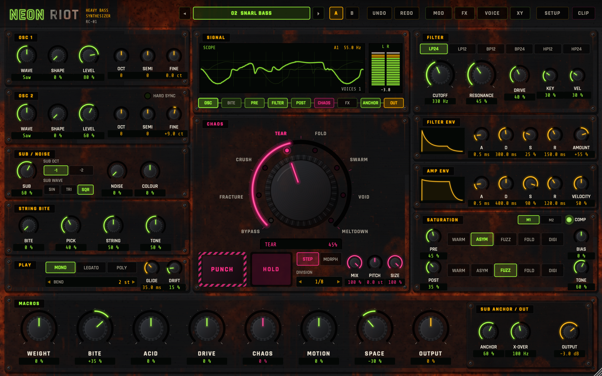
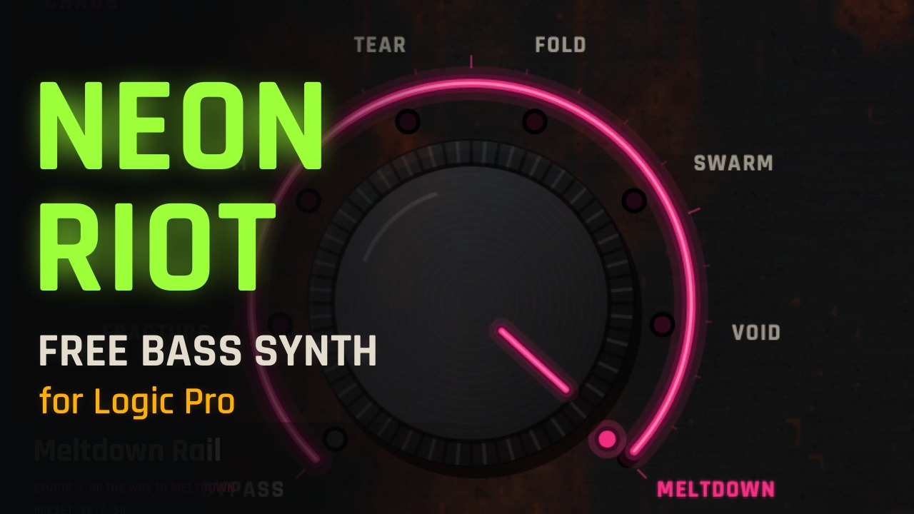

# NEON RIOT

A heavy bass synthesizer for Logic Pro (Audio Unit instrument, Apple Silicon and Intel).

> Made by **Rob Cawley**, a musician in Dublin, for his own records, and shared free for anyone to try.
> If you make something with it, I'd love to hear it. Post it anywhere, and if you like, link back to my music:
> **[robcawley.com](https://robcawley.com)** · **[Bandcamp](https://robcawley.bandcamp.com)** · the new album **[Room Tone](https://robcawley.com/roomtone/)**.

*▶ Watch the preset showcase on YouTube.*

## What it does

- Two oscillators, a sub and noise, a resonant filter, envelopes with live curves and a saturation stage built for weight rather than fizz.
- **STRING BITE** adds pick and pluck articulation; **CHAOS** adds controlled instability, from slight drift to a voice that sounds like it's failing.
- Eight centre-neutral macros: at noon every preset plays exactly as designed, and you push or pull from there.
- Modulation, stereo effects, voice modes, an XY pad and MIDI learn.
- 56 factory presets, from tight bass lines to slow cinematic beds and drones.

## Download

Get the ready-built plug-in from the **[latest release](https://github.com/robcawley/neon-riot/releases/latest)** (macOS 12 or later, Apple Silicon and Intel).

1. Unzip it and move `NEON RIOT.component` into `~/Library/Audio/Plug-Ins/Components` (in Finder: Go → Go to Folder…, then paste that path).
2. The plug-in isn't signed with an Apple developer certificate, so macOS blocks it the first time. Open Terminal and run:

       xattr -dr com.apple.quarantine ~/Library/Audio/Plug-Ins/Components/"NEON RIOT.component"

3. Restart Logic. It appears under AU Instruments → Rob Cawley → NEON RIOT.

## Build from source

Or build it yourself on a Mac with the Xcode Command Line Tools and CMake.

    git clone https://github.com/robcawley/neon-riot.git
    cd neon-riot
    git clone --branch 8.0.4 --depth 1 https://github.com/juce-framework/JUCE.git JUCE
    cmake -S . -B build -DCMAKE_BUILD_TYPE=Release
    cmake --build build -j 8

The build copies the plug-in to `~/Library/Audio/Plug-Ins/Components`. In Logic: AU Instruments → Rob Cawley → NEON RIOT.

## Sister projects

- [ROB KIT](https://github.com/robcawley/rob-kit): a human-feeling drum instrument.
- [BRUISER](https://github.com/robcawley/bruiser): a drummer that plays ROB KIT.
- [THE GREAT COMPOSER](https://github.com/robcawley/the-great-composer): chords in, orchestral MIDI out.

## Licence

AGPL-3.0 (see `LICENSE`), the same open-source licence as the JUCE framework it's built on. Fonts: Rajdhani and Share Tech Mono, SIL Open Font Licence.
